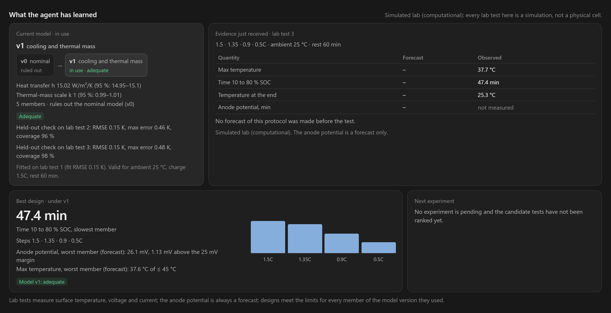
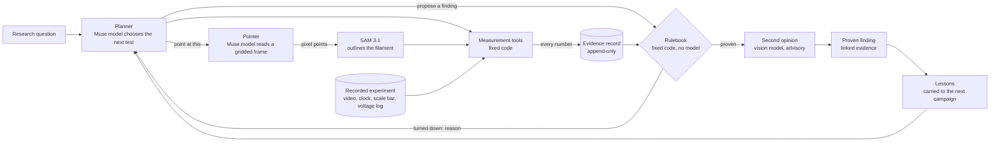

# Translucent

Translucent is an agent for hardware engineering teams. A team brings the records of a test that failed and
states what must improve and which limits must hold. The agent proposes each next experiment with its reasons and a
prediction for every quantity it expects to change. An engineer approves the exact version they read. The server
runs computational experiments itself, and physical ones wait for a person to upload the result. A fixed rule
compares every result with the failing baseline. The campaign ends with the baseline against the best candidate,
or as unresolved with its reasons.

Every proposal, approval, run and comparison is kept in an insert-only, hash-chained ledger. Anyone can re-check a
campaign offline without our keys. The agent is Muse Wonder on the Meta Model API. A team can connect its own agent
over MCP instead. It gets the same tools and the same rules, and it can never approve its own work.

Batteries come first, on a fast-charge problem for the LG M50 cell. In the earlier fixed-model study, case-median
charging times were within 0.24 minutes of a reference search (a deterministic compass search on a 0.05C lattice;
no search proves a protocol optimal), and all three held-out-case runs matched its best result. These were
simulation results under an eight-query budget. In the later learning-and-design study, adaptive Muse matched the
adaptive numerical controller under the registered comparison rule, using more simulated lab tests. In the
records-intake study, a general Muse agent produced six feasible recommendations at 39% of Translucent's model
spend; Translucent produced five feasible recommendations and enforced its standing rule in every run. Every lab
result is simulated; no physical cell was charged.

Earlier work used the same evidence record to [check microscopy measurements](#microscopy-campaigns) and to
[test interventions on NIST heating-interruption records](#nist-heating-interruption). Every finding there links to
its frames, lab clock, voltage data and analysis code, in a receipt that can be checked offline with one command.

## Engineering campaigns

### How a campaign runs

1. **Import.** The team's records are imported as published, with their units and time bases, and checked against
   pinned checksums.
2. **Registration.** An engineer registers the objective: the quantity to improve, the limits that must hold and
   the experiment budget. The objective pins the system's code and solver. The failing baseline is re-run on the
   solver at once, so every candidate is compared with it on the same basis.
3. **Proposal.** The agent proposes an experiment with its parameters, reasons, expected effect and a predicted
   range for each quantity. Parameters outside the system's bounds are refused before anything is written.
4. **Approval.** The engineer approves a content hash, the version they read. A request revised after they read it
   needs a new approval.
5. **Execution.** A computational request runs once, also across a server restart, in a child process that holds
   no keys. A physical request waits for a person's upload. Results in a unit that cannot be converted, from a
   configuration outside the approved tolerance, or from a specimen an earlier test destroyed are refused, and the
   refusal is recorded.
6. **Comparison.** The target must improve beyond its margin with both uncertainties counted, and every limit must
   hold. A candidate that meets the limits a failing baseline breaks wins even when it is slower, and the price is
   shown. Anything the uncertainties cannot decide is inconclusive.
7. **Conclusion.** The outcome is computed from the comparisons. The agent does not write it.

An engineer can tighten a limit or add one mid-campaign. Earlier results are compared again under the amended
objective, and the ledger keeps both. Details are in [docs/LOOP.md](docs/LOOP.md).

### First campaign: a faster charge for the LG M50 cell

A protocol charges the LG M50 21700 cell (Chen et al. 2020 parameters) from 10 to 80 % at 1.5C in four windows. It
takes 28.2 min, and it fails. The anode falls to +7.3 mV against lithium, inside the margin where lithium can plate,
and the cell reaches 51.2 °C against a 45 °C limit. The campaign asks for the fastest four-step protocol that keeps
the anode at or above +10 mV and the cell at or below 45 °C. Experiments run on PyBaMM's DFN model with lithium
plating and lumped thermal behaviour.

The evaluation protocol was fixed before any run was scored ([evals/FASTCHARGE-PROTOCOL.md](evals/FASTCHARGE-PROTOCOL.md)).
Each arm had eight experiments. The model arms had $1.50 of model calls per campaign. Case A is the problem above.
In case B the engineer raises the plating margin from +10 to +25 mV after the fourth experiment. Case C moves the
cell to 15 °C and was held out while the system was built.

Median best protocol that meets every limit, minutes from 10 to 80 %:

| Case | Agent campaign | Same model, no feedback | Constrained BO | Best found by the reference search |
|---|---|---|---|---|
| A, 25 °C | **33.79** | 36.29 | 42.62 | 33.55 |
| B, margin raised to +25 mV | **37.17** | 44.29 | 42.62 | 37.13 |
| C, 15 °C, held out | **34.13** | 39.50 | 45.98 | 34.13 |

The agent ran 3 campaigns per case and reached the best protocol found by the reference search in all 3 for case C. The no-feedback arm is the same model
planning all eight experiments at once without seeing a result. The BO arm ran 5 seeds per case.

The amendment in case B changed what the agent did next. We replayed its fifth turn from the same history, with and
without the amendment, three times. Without it, the agent proposed 1.1C in the last window. With it, the agent
proposed 0.7 to 0.8C and predicted a lowest anode potential of +25.0 to +28.0 mV.

The first case B campaign ships as a recording, `web/public/fixtures/loop/fastcharge.loop.json`. The web app opens it
from its home screen (`/w/?recording=fastcharge`): the agent's eight experiments with their reasoning, the amendment,
and baseline against candidate. Check it offline with `uv run translucent verify web/public/fixtures/loop/fastcharge.loop.json`.

A second recording, `web/public/fixtures/loop/fastcharge-demo.loop.json` (`/w/?recording=fastcharge-demo`), is a
demonstration, not part of the benchmark: case B run once through the web app on October 31, 2026, with every
request approved by hand, the margin raised to +25 mV after the fourth experiment, and the campaign concluded by hand.
The planner stopped on its $1.50 model budget after five experiments ($1.27 spent). The best, 1.5, 1.4, 1.1 then 0.8C,
takes 37.17 min with the anode at +25.9 mV and the cell at 44.5 °C, against 70 min for the fastest single-step
constant-current charge the product's reference search found under the same limits (0.6C). It is simulated.

The records alone cannot answer the question. They include a 0.3C constant-current then constant-voltage charge
taking 140.0 minutes; that is a recorded protocol, not a matched physical baseline for the simulated fast-charge
designs. They hold no anode potential, so the plating margin cannot be checked on them.

What the agent pays for its result:

- It ran a median of 4 experiments out of 8 that broke a limit in cases A and C. BO ran 2. The agent probes the
  boundary on purpose, and on real hardware each of those runs would cost cell time.
- Its model calls cost a median of $1.13 to $1.22 per campaign, against $0.23 to $0.25 without feedback. A campaign
  took 4.1 to 4.8 min against 1.4 to 1.6 min.
- Two of the three case C campaigns ended on the $1.50 budget, after reaching the best protocol found by the reference search.

All of this is computational. The result says that the loop finds good protocols under this model. A physical test
of the case A protocol on a real cell is the next step, and it needs qualified operators. Translucent issues that
request and records its result. It does not run hardware. Full tables, per-run results and spend are in
[evals/FASTCHARGE.md](evals/FASTCHARGE.md).



In a simulated lab the agent fitted model v1 (5 members, h 14.95–15.1 W/m²/K), checked it on two held-out lab tests
(RMSE 0.15 K) and lab-tested its best design: 1.5, 1.35, 0.9 then 0.5C, 47.4 min from 10 to 80 %. All of it is
simulated. More in [docs/OVERVIEW.md](docs/OVERVIEW.md).

## Battery research

### Simulated learning and records-intake evaluations

The [learned-model evaluation](evals/FASTCHARGE-LAB.md) compares adaptive Muse with an adaptive numerical
controller under a [fixed protocol](evals/FASTCHARGE-LAB-PROTOCOL.md). They matched under the registered criteria;
Muse did not outperform the numerical controller.

In the [records-intake evaluation](evals/RECORDS-INTAKE.md), Translucent recommended a design in five of six runs.
All five were feasible, with no unsupported recommendations. A general Muse agent using the same underlying parser,
solver and simulated lab, through its own tool interface and prompt, recommended in six of six runs at about 39% of
Translucent's model spend, with one unsupported recommendation. The numerical controller on prepared inputs
declined in all three cases. These are simulated outcomes with six runs per model arm, without a claim of
statistical superiority. The reports identify the frozen plan, copied scores and the evidence still required for
exact historical reproduction.

In a records investigation, Muse reads the supplied exports and their documentation, writes the import mapping
(refused imports come back with the line and the reason), chooses record tests, model families and held-out checks,
and asks for the next experiment. Import notes record every skipped line, repeated time and unit taken from the
mapping. When no supported model family explains the lab's tests, no design is recommended and the campaign names
the evidence and modelling capability it lacks. A bench test, once approved, shows its procedure, configuration,
specimen and the series to log; the engineer returns the logged file in the browser, the server checks it against
the approved request, and the campaign continues from it.

In 2023, lithium-ion battery fires killed 18 people in New York City alone. Samsung recalled 3.1 million Galaxy
Note 7 phones over faulty batteries, at an estimated $5.3 billion. GM recalled all 143,000 Chevy Bolts in a battery
recall costing about $2 billion.

Solid-state cells replace the flammable liquid in today's batteries. Toyota aims to put them in cars in 2027–28.
In the lab, these cells still "invariably fail" when lithium filaments grow through the solid and short the cell
(Reisecker et al., Nature Communications 2023). Lithium plating also limits fast charging. Researchers call it
"the major degradation mechanism that impairs the safety and fast charge capabilities" of car batteries
(Lu et al., Nature Communications 2023).

Scientists film these processes under a microscope and measure the footage. Errors can enter through a playback
clock used as lab time, a scale bar from another experiment, swapped movies or an outline around the whole sample.
In one published movie, each captured image is 6.9 seconds of lab time but 0.4 seconds of playback. An analysis
that trusts the playback clock reports the filaments growing 18× faster than they did, with no warning. An agent
can carry errors like that into a finding. Translucent checks whether each measurement uses the recorded
clock and calibration, and whether the evidence supports the proposed finding.

## Microscopy campaigns

### Research workflow

1. A scientist asks about a recorded experiment: "How fast do the lithium filaments grow, does the battery
   short when they bridge it, and does it recover when they retract?"
2. A Muse model plans tests. A Muse model locates objects in the frame, using the lab's recorded frame layout
   (where the sample and electrodes sit), and SAM 3.1 outlines them.
3. Fixed code measures lengths, speeds and times using the lab's clock and scale bar. Playback speed is never
   used as lab time.
4. The rulebook re-computes each proposed finding from its recorded measurements. It returns proven, disproven,
   not settled by this data, or not enough evidence yet, with a reason.
5. When a finding is rejected, the agent reads the reason and runs the test needed to resolve it.
6. People inspect the evidence down to the frames and code. They can share a link or QR code and re-check it
   offline.

### Working together

Scientists can leave a note while the agent runs, pause it or stop it. A note such as "check both onset definitions"
reaches the agent before its next step. The agent asks people for information the records cannot supply, such as
the cell identity or the scale-bar length. If nobody answers in time, it continues with the available records.

A sign-off or challenge is recorded with the person's name beside the checker's verdict. Neither changes that
verdict. A challenge sends the finding back to the agent for re-examination. Failed model calls are retried
and metered. A stopped or interrupted campaign resumes from its evidence.

Scientists can upload a video with its scale, clock and voltage log, recording the source of each. The video's
frame rate is never used as a clock. See [docs/BRING-YOUR-OWN.md](docs/BRING-YOUR-OWN.md).

Claude Code or any MCP client can run Translucent's measurement tools and propose findings over MCP. The client
cannot write a measurement number or verdict directly. The same checks and rejection reasons apply. See
[docs/AGENTS.md](docs/AGENTS.md).

The Movie 4 campaign below records this collaboration over the HTTP API, live on Meta's models. Ana supplied a
note and signed off a finding. Ben challenged another, and the agent returned a narrower finding that the checker
proved.

### Microscopy evaluation

#### Planted mistakes

Each test plants one mistake, then proposes the finding implied by the faulty data. The cases include a wrong
scale, playback timing, swapped video, invalid outlines and a voltage log that does not support a short. A check
must detect the faulty evidence to reject the finding.

| | Translucent | Normal pipeline (SAM + fixed measurement code) |
|---|---|---|
| Planted data mistakes caught | **24 of 24** | 1 of 24 |
| All planted faults, including faked or retracted records | **38 of 38** | 1 of 38 |

The normal pipeline catches a mistake only if it crashes. Its one catch was a length with no scale, which raised
an error. It does not check whether its inputs belong together. The other 14 faults concern fabricated
measurement records, numbers typed into analysis code, withdrawn evidence and an overreaching second opinion.
These have no equivalent in the baseline script, so they are reported separately.

#### Model double-check

We asked Muse Spark Open, the model used for the second opinion, to check each finding produced by the planted
mistakes, 3 times each (120 real calls, $0.95). Given a finding and its numbers, it accepted **5 of 18** planted
mistakes (4 of 11 data mistakes) and rejected 1 of 2 correct findings. Given the full evidence record as text, it
caught all 18 and accepted both correct findings.

This experiment shows that the evidence supplied to the reviewer affects the result. The rulebook checks that
record for every finding without a model call. The other 20 planted mistakes were stopped before they produced a
finding for the model to judge.

#### The 18× timing error

A test filament grows at a known speed using Movie 4's recorded clock and scale. Timing the same images by
playback produces the following error:

| | Speed |
|---|---|
| Truth | 6.203 µm/s |
| Translucent | **6.200 ± 0.018 µm/s** (95% interval), passed the rulebook's checks on this synthetic control |
| Normal pipeline | 112.82 µm/s, 18.2× too fast: it timed playback frames (each image is 6.9 s of lab time, 0.4 s of playback) |

#### Agreement with the paper

On the real Movie 4 voltage log, Translucent measures the first short at 89.6 ± 3.5 s and the second at 351 ± 7 s.
The paper's voltage data puts them at 86–93 s and 345–358 s (Reisecker et al., Nature Communications 2023).
Both measured windows overlap the paper's.

#### Movie 4 team campaign

Muse Wonder planned the tests. Muse Spark located the filament lanes, and SAM 3.1 outlined them live. Ana left a
note before the first step describing the electrodes and the five lanes where the filaments grow. The agent
outlined those lanes.

From the voltage log, the rulebook proved the first short at 89.6 ± 3.5 s, recovery at 215 s and a second short at
351 ± 7 s. Ana signed off the first short: "Matches the voltage log I recorded."

Using the outlines with the lab's clock and scale, it proved growth at 55–72 µm/s (63.7 ± 4.0) and retraction at
48–73 µm/s. It also proved that the typical filament length stayed near 1440 µm (1439 ± 38).

Ben challenged the growth speed: "Is this speed from the growing phase only, before the short at 90 s?" The agent
computed the speed using only points before the short. The rulebook proved that narrower finding too.

The campaign did not prove that the filaments bridge the gap. It recorded a lesson: an outline measured from one
electrode can merge with the far electrode. The tip must be checked against both electrode edges first.

The campaign proposed 12 findings: the rulebook supported 7, found 4 inconclusive and rejected 1.
`translucent verify` reconstructs all 12 and their recorded statuses offline. Every analysis number passed the input
check described below.

#### Detecting numbers typed by our own agent

The first Meta run of Movie 4 also "proved" a growth speed, a filament length and an electrode gap. Inspection of
the evidence showed that the planner's sandboxed code had copied numbers from earlier tool output and chosen its
own error bars. It had not read the recorded measurements it declared as inputs.

Analysis code now runs a second time with inputs changed by a fraction of a percent. Any output or error bar that
does not change with them is rejected. This failure is now a planted mistake in the evals. The earlier run remains
as evidence of the failure. Both microscopy campaigns were re-run with the check in place.

#### Graphite during fast charging

On graphite during fast charging (Lu et al. 2023), the rulebook proved that cell voltage first fell below 0 V after
about 7.4 hours, 2.6 ± 0.7 hours before the paper's stated plating onset of 10 hours. The campaign did not prove
whether plating was visible earlier in the movie. It started with Movie 4's lessons loaded and recorded another:
the gold colour of lithiated graphite can be mistaken for plating.

#### Visual second opinion

A vision model reviews one evidence image per proven finding. In 16 seeded cases tested 3 times each (48 real
calls, $0.21), it never agreed with a wrong finding (0 of 33). It missed a correct finding 20% of the time. This
review is advisory and cannot overrule the rulebook.

#### Cost

On Meta's models, model calls for the Movie 4 team campaign cost $3.00. The graphite campaign cost $0.88.

#### Known limits

- Without a recorded clock, repeated images are not removed. The rulebook still refuses the resulting speeds.
- The visual second opinion runs only after the rulebook returns "proven". A fault the rulebook misses gets only
  that one advisory review.
- Loading lessons has not improved the next campaign in the tested task. In a real memory test (Muse Spark Open,
  3 repeats per arm, $0.37), a lesson about bridging led the agent into unnecessary video analysis for a question
  about short timing. It took 11 steps instead of 6 and produced the same 3 findings. Retrieval was then restricted
  to relevant lessons; that change has not been re-evaluated. See [evals/MEMORY.md](evals/MEMORY.md).

## NIST heating-interruption

When a lab or battery management system cuts the heat to a cell under thermal abuse, it must decide whether
stopping the heat is enough. NIST's heating-interruption experiments (Tam et al., Applied Thermal Engineering)
recorded cells that ignited after their surface temperature had fallen. In nine 21700 trials the surface cooled at
least 2 °C after heater-off and the cell still ignited; in Exp 81 it fell 14.6 °C over 182 s and the cell ignited
297 s after heater-off. Translucent tests decisions at that recorded heater-off point.

The agent records competing mechanistic hypotheses and proposes executable strategies. Each combines a world
model with a cost-based decision rule. It screens strategies on training folds only, then commits to stand down,
escalate, or pay to watch 30 or 60 s before the controller reveals the outcome. Outcomes are sealed as hashes.
The agent labels all forecasts simulated. Leave one condition out is the primary split; leave one format out
and prequential evaluation test transfer and sequential updates.

The registered costs are fixed before scoring: unsafe stand-down costs 100, ignition during a watch costs 100,
unnecessary escalation costs 10, and watching costs 0.05 per second. Escalating on a trial that ignites costs 0;
the experiments did not observe whether escalation would have helped. The seals establish the record's internal
order; the public dataset had already been studied.

`translucent verify` recomputes every fit, every decision, every score and every gate verdict offline without
keys. It rejects forged ledgers from an independent review with specific reasons: edited ignition times fail
the outcome checks, a fit trained on held-out labels fails the refit checks, and Muse decisions without receipts
fail the model-request checks. The 1500-decision scripted receipt verifies in about one minute.

No agent strategy beats always-escalate after Holm correction. On the 50-trial primary split, the best scripted
agent costs 3.72 per trial against 3.80 for always-escalate (Holm p = 1). These are mean registered costs;
they do not measure the effectiveness of an actual rescue.

Across two live Muse Wonder planner campaigns, costing about $4 each, the best strategies recorded 0 unsafe
stand-downs and 2–4 fewer missed rescues than always-escalate. The differences were never significant
(raw p = 0.125–0.5, Holm p = 1). A missed rescue here means escalating on a trial that did not ignite.

The deterministic gate refused the agent's own claim that it beat always-escalate at 3.4 versus 3.8 mean cost
(p = 0.5, Holm p = 1). The operating procedure the agent then wrote cites only supported claims.
On the same trials, Muse Wonder deciding alone made 4 and then 6 unsafe stand-downs; the final selected procedure
in each campaign made none, while other candidate policies made 1, 4 or 5. The comparison with Muse deciding alone
was selected after the fact, was not registered, and does not survive the correction (raw p = 0.125 and 0.031).

The gate records wins over the fixed 170 °C rule and the two physics models. Those wins reflect a decision-rule
asymmetry and baselines that never discriminate under their classification rules. The temperature cut is
illustrative and unsourced. Applying the common cost rule removes the fixed-temperature advantage; no
condition-clustered comparison survives correction. Post hoc, a 155 °C threshold picked on these same trials
costs 2.4. That is a descriptive check on how little signal is available, not evidence for a selected policy.

The agent runs from recorded observations through an executable model to committed interventions and sealed
outcomes on real data. Anyone with the receipt can check every number. The system refused to overclaim its result.

See [the intervention protocol](docs/INTERVENTION.md) and [benchmark results](evals/INTERVENE.md).
The exported [scripted receipt](web/public/fixtures/nist-bench.json) contains the evidence for offline checking.
[Run the benchmark or estimate a live campaign](#nist-interventions).

## Meta's models

The engineering campaigns and both microscopy campaigns ran on the Meta Model API. Each replay names the model used
for each role. The live server uses the same configuration (`TRANSLUCENT_PROFILE=meta`).

| Role | Model (`meta` profile) |
|---|---|
| Campaign agent: proposes experiments with predicted ranges, reads results and comparisons, asks the engineer when the records cannot answer | Muse Wonder (Meta Model API) |
| Planner: selects tests, reads rejection reasons and asks people for missing information | Muse Wonder (Meta Model API) |
| Pointer: reads a gridded frame and returns pixel points on filaments or electrodes | Muse Spark (Meta Model API) |
| Outliner: converts points and boxes to outlines and tracks them | SAM 3.1 (Meta Model API), live, every call recorded |
| Second opinion: reviews one evidence image; advisory | Muse Spark Open, Meta's open model (Fireworks) |

The `dev` profile runs every role on Muse Spark Open through Fireworks and replays recorded SAM 3.1 calls. Tests
and evals use these recordings without paid calls.

## Model observations

- SAM 3.1 text prompts such as "dendrite" or "thin dark line" returned no frames on battery microscopy. Point and
  box prompts worked. On Movie 1, SAM's filament tip agreed with a classical tip detector to a median of 4.5 px.
  The Muse model therefore supplies points for SAM to outline.
- Video tracking worked forward only. Backward and both-direction tracking failed on the server side.
- In Movie 4, rapid growth between captured images broke tracking. We re-point SAM on every captured image at
  fixed roots, at $0.0025 per image.
- SAM output varies between runs. Every call is recorded, and replays use that recording. The default
  `TRANSLUCENT_SAM=strict` mode never re-calls SAM or substitutes a near-match.
- Muse tool calling requires `tool_choice: "auto"`. Muse Spark Open sometimes emits a tool call as chat-template
  text or invents measurement ids. The runtime hides the text and retries. It rejects invented ids.
- The Meta Model API rejected some JSON-schema regexes: a Python `\Z` gave "400 Invalid JSON schema". Tool schemas
  now use the portable subset. A rejected request ends a campaign with a recorded reason.
- The pointer once outlined the paper's plot beside the microscopy image in Movie 4. Frames now include the
  recorded layout and a grid in source-video pixels.

## Measurement and evidence



The planner runs the campaign and calls tools. The pointer only locates objects in one frame. Measurements use
decoded source frames and a stored frame-to-lab-time mapping. Repeated playback frames are collapsed into captured
images when a recorded clock is available. Operando microscopy records the battery as it charges and discharges.

The evidence ledger uses SQLite and content-addressed files. Records can be added but never edited. Each
measurement stores its run, input/output/code/prompt hashes, calibration, cost and uncertainty. Status changes are
new events. Withdrawing a run marks dependent findings as stale through their evidence lineage.

The deterministic checker in `translucent/gate.py` re-computes each finding from its cited measurements. It checks
that they trace to successful runs and have the correct units. A length requires a recorded scale; a speed
requires a recorded clock from the same recording. Findings that need independent corroboration must include it,
such as voltage collapse for a short.

The checker returns one of four outcomes: supported, refuted, inconclusive or not enough evidence. Inconclusive
means the data cannot distinguish the answers. Not enough evidence means a required measurement is missing.
A tool failure never refutes the science. A test too imprecise to distinguish values cannot return supported.

After the checker supports a finding, the vision model reviews one evidence image. This advisory second opinion cannot
override the checker. Lessons are stored with their evidence and loaded at the next campaign's start. Experiments
are recorded and replayed through the same instrument interface a live microscope would implement.

## Run it

Requirements: Python 3.11+ with [uv](https://docs.astral.sh/uv/), and [bun](https://bun.sh) for the web demo.
Browsing, replaying and verifying need no provider keys.

```sh
uv sync --group dev
uv run python scripts/fetch_data.py   # the papers' supplementary movies into data/raw/ (about 106 MB)
```

The movies are not in git. `scripts/fetch_data.py` downloads them from the publisher and checks each against the
sha256 the experiment records are pinned to (`translucent.instruments.RECORDED_FILES`); a file that differs is
refused. Name some to fetch only those, e.g. `scripts/fetch_data.py reisecker2023/movie4` for the command below.
Browsing, replaying, verifying and most tests do not need them.

### Engineering campaign

```sh
uv sync --group dev --group solver             # adds PyBaMM, which runs the experiments
uv run python scripts/fetch_lgm50_data.py      # the Chen 2020 LG M50 records, 1.8 MB, checked by sha256
uv run translucent start fastcharge --data-root ./lab --person Ana --serve
```

In a second terminal, start the web app and open http://localhost:3000:

```sh
cd web
bun install
NEXT_PUBLIC_API_BASE=http://localhost:8000 bun run dev       # PowerShell: $env:NEXT_PUBLIC_API_BASE="http://localhost:8000"; bun run dev
```

Use `localhost` for the server too, not `127.0.0.1`: the sign-in cookie is sent only to the same site as the page.

The first start makes an engineer key for `--person`, prints it once and keeps it in `lab/team-key` (readable by
you only). Sign in with it once in the web app; the session lasts 12 hours and survives a server restart. From there
**New campaign** walks through system, dataset (with its records and units), objective and constraints, planner,
budgets and approval policy. The server accepts the web app from `http://localhost:3000`; for another address, set
`TRANSLUCENT_CORS_ORIGINS`.

New campaigns ask for the fastest protocol meeting the constraints, unless the engineer sets a hard time target, and
keep three answers apart. A result that meets limits a failing baseline breaks is *feasible*; it is called *faster*
only against a reference that meets the same limits (the baseline when it does, else the fastest single-step
constant-current charge a reference search finds on the solver, run again after a constraint is amended); the
objective is *met* only against a hard target. Solver tolerance and the model's own error against cells are shown
separately.

#### Keys and roles

Every read and write needs a key. Make one per person or agent; each is shown once and only its hash is kept:

```sh
uv run translucent keys add --name Ana --role engineer --data-root ./lab     # runs campaigns
uv run translucent keys add --name Vic --role viewer --data-root ./lab       # read-only
uv run translucent keys add --name lab-bot --role planner --ledger lab --data-root ./lab   # an agent over HTTP
uv run translucent keys list --data-root ./lab
uv run translucent keys revoke KEY_ID --data-root ./lab                      # ends its browser sessions too
```

`viewer` reads. `engineer` also opens campaigns with the free planners, approves, rejects, revises, submits results,
uploads, imports datasets, notes, concludes and lowers budgets. `admin` also raises budgets and starts paid runs
(with `TRANSLUCENT_LIVE=1` and the provider keys). `planner` is an agent's key: it proposes, defines measurements and
cancels its own requests, never a person's work. `--ledger ID` (repeatable) limits a key to some ledgers; other
ledgers answer 404. Who acts is always the key's person or agent, never a name in the request body. HTTP clients send
`Authorization: Bearer KEY`. `TRANSLUCENT_TEAM_TOKEN` and `TRANSLUCENT_ADMIN_TOKEN` still work as one engineer and
one admin key (32 characters or more).

`start` creates the ledger, imports the records, re-runs the failing protocol and opens the campaign. Running it
again changes nothing. Choose who proposes with `--planner`:

| Planner | Who proposes | Cost |
|---|---|---|
| `bo` (default) | constrained Bayesian optimisation | none |
| `external` | your own agent, over MCP or HTTP | yours |
| `muse` | Muse Wonder, $1.50 model budget | paid: needs `--live` and an admin key |

Each request waits for a person's approval in the web app; `--auto-approve` lets computational requests run
without one. With `--planner external`, `start` prints the MCP command that connects your agent to the campaign
(see [docs/AGENTS.md](docs/AGENTS.md#loop-campaigns)).

### CLI

```sh
# Run a campaign on a recorded movie (paid, metered calls; --profile dev = Muse Spark Open on Fireworks,
# --profile meta = Muse Wonder + Muse Spark on the Meta Model API)
uv run translucent run --ledger runs/m4 --movie 4 --profile dev --budget 1 --steps 30 --memory on

# Export a campaign for the web demo or for sharing (no provider calls). An engineering campaign is written as one
# <name>.loop.json file that `translucent verify` re-checks
uv run translucent export <campaign-id> <out> --ledger <ledger-dir>

# Read provider balances (read-only)
uv run translucent budget
```

### NIST interventions

These commands make no provider calls. Use a fresh output directory to preserve published reports.

```sh
# Rebuild the scripted benchmark across the registered splits and sensitivities
uv run translucent bench nist --out runs/nist-benchmark

# Verify the self-contained receipt without keys
uv run translucent verify web/public/fixtures/nist-bench.json

# Estimate a Muse Wonder planner campaign without contacting a provider
uv run translucent intervene nist --profile meta --budget 25 --split loco --dry-run
```

To replay a recorded planner campaign, use `--replay <recordings-dir>` with its original profile, budget, split
and step cap, and a fresh ledger directory. See
[the replay instructions](docs/API.md#nist-live-planner-and-recorded-replay).

### Offline verification

Verification re-checks every recorded finding in a ledger or exported bundle, including evidence file hashes and
event order. It exits 0 only if everything matches. Otherwise it prints one line per problem. Findings are re-checked
with the gate rules they were recorded under (see [docs/CONTRACTS.md](docs/CONTRACTS.md)), and a note names any
finding today's gate would decide differently.

```sh
uv run --group dev translucent verify <ledger-dir | export-dir>   # optional: --campaign <id>
```

### Add a recording

Importing a recording needs no provider calls. See [docs/BRING-YOUR-OWN.md](docs/BRING-YOUR-OWN.md).

```sh
uv run translucent add-experiment --id cell-042 --video cell042.mp4 --title "Cell 042" --citation "Notebook p. 42"   --licence "Internal" --author "Ana" --scale-bar-px 100 --scale-bar-um 50 --scale-source "Calibration slide"   --timestamps frames.csv --clock-source "Acquisition log"
uv run translucent experiments                     # list
uv run translucent resume <campaign-id> --budget 0.5   # continue a stopped or interrupted campaign (paid)
```

### Agent access

To connect an agent over MCP, use `claude mcp add translucent -- uv run python -m translucent.mcp_server
--ledger <dir> --write --agent <name>` ([docs/AGENTS.md](docs/AGENTS.md)). The MCP server acts as the operator who
started it: proposals are recorded as `agent:<name>`, whatever name the client gives itself, and person tools need
`--operator NAME`.

### API server

Every route needs a key (see Keys and roles); only `/api/session` and `/api/health` are open. Starting paid
campaigns over HTTP requires `TRANSLUCENT_LIVE=1` and an admin key.

```sh
uv run translucent serve --ledger <ledger-dir> --state <state-dir>   # http://127.0.0.1:8000/api/campaigns
```

The ledger must exist; `--create-ledger` starts the server on a new, empty one.

A container recipe is in [`deploy/README.md`](deploy/README.md). Endpoints are in [docs/API.md](docs/API.md).

### Web demo

The Next.js app replays exported campaigns from `web/public/fixtures/`. With `NEXT_PUBLIC_API_BASE` set to a running
server, it also lists that server's engineering campaigns: approve or reject each request, follow it while it runs
and read the comparison with the baseline. The app labels a live campaign and a replay differently.

```sh
cd web
bun install
bun run dev        # http://localhost:3000
bun run build      # static export to web/out; `bun run start` serves it
```

The home screen leads with the server's engineering campaigns and the recorded fast-charge campaign
(`fixtures/loop/fastcharge.loop.json`). Below them it offers the NIST benchmark and the microscopy replays `m4-team`
and `lu-live`, exported from real paid campaigns on Meta's models over the HTTP API
(Oct 29). The thread labels each as a recorded replay and names the model used for each role. The earlier Meta
runs, `m4-meta` and `lu-meta`, predate the analysis code check and remain as evidence. The Fireworks exports,
`m4-dev` and `lu-dev`, remain for comparison.

The `m1` and `lu` fixtures are hand-authored design narratives over real data. They are used only for UI
development and are not offered on the start screen.

### Read-only MCP server

The read-only server supports Claude Code or any stdio MCP client. Its tools are `list_campaigns`, `list_findings`,
`get_evidence` and `verify`. It never starts a campaign or contacts a provider.

```sh
claude mcp add --transport stdio translucent -- uv run --directory /absolute/path/to/translucent --no-sync \
  python -m translucent.mcp_server --ledger /absolute/path/to/ledger
```

### Evals

```sh
uv run python -m evals.run            # fault injection vs plain pipeline, offline -> evals/REPORT.md
uv run python -m evals.critic_eval    # critic harness, offline; --real --repeats 3 --budget-usd 2.5 is paid
uv run --group dev pytest tests -q
```

Every paid call is metered against hard provider caps (`translucent/budget.py`, `translucent/providers.py`).

## Project layout

```
translucent/      runtime (runtime.py), checker (gate.py), ledger (ledger.py), tools (tools.py),
                  SAM recording/replay (recordings.py), outline QC (qc.py), sandboxed analysis (analysis.py),
                  offline verify (verify.py), API (server.py), MCP (mcp_server.py), CLI (cli.py)
                  NIST intervention controller, executable world models and cost-based decision rules
                  engineering campaigns: lifecycle (loop.py), comparison (loop_compare.py), planner
                  (loop_planner.py), HTTP and MCP capabilities (loop_surface.py), systems/ (LG M50 adapter, solver)
evals/            fault injection, plain-pipeline baseline, critic eval, model double-check, memory test;
                  REPORT.md, CRITIC.md, LLM_JUDGE.md, MEMORY.md
                  NIST intervention benchmark (INTERVENE.md), generated results and ledgers
                  fast-charge campaign evaluation (FASTCHARGE.md, FASTCHARGE-PROTOCOL.md)
data/groundtruth/ published numbers digitised from the papers, with provenance (README.md)
web/              Next.js app (app/, components/, lib/)
                  scripted NIST receipt (public/fixtures/nist-bench.json)
scripts/          campaign runner, SAM recording, time bases; groundtruth/ derives the lab records from the papers
runs/             recorded campaign ledgers used by evals and the container
state/            live intervention ledgers and private planner recordings (git-ignored)
tests/            pytest suite
deploy/           API and web containers
docs/             engineering campaigns (LOOP.md), API, agents over MCP, bringing your own recording, replay-bundle schema
                  intervention protocol (INTERVENTION.md), intervention bundle contract (CONTRACTS.md)
```

## Data and licences

The microscopy experiments come from two open-access papers. Their articles and supplementary movies are
published under [CC BY 4.0](https://creativecommons.org/licenses/by/4.0/). The videos are used unchanged.
The overlays and measurements are ours.

- Reisecker, V., Flatscher, F., Porz, L., et al. *Effect of pulse-current-based protocols on the lithium dendrite
  formation and evolution in all-solid-state batteries.* Nat. Commun. 14, 2432 (2023).
  [doi:10.1038/s41467-023-37476-y](https://doi.org/10.1038/s41467-023-37476-y). Supplementary Movies 1-5.
- Lu, X., Lagnoni, M., Bertei, A., et al. *Multiscale dynamics of charging and plating in graphite electrodes
  coupling operando microscopy and phase-field modelling.* Nat. Commun. 14, 5127 (2023).
  [doi:10.1038/s41467-023-40574-6](https://doi.org/10.1038/s41467-023-40574-6). Supplementary Movie 1 and
  Source Data.

Code licence: [MIT](LICENSE).
