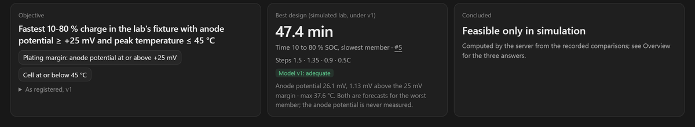
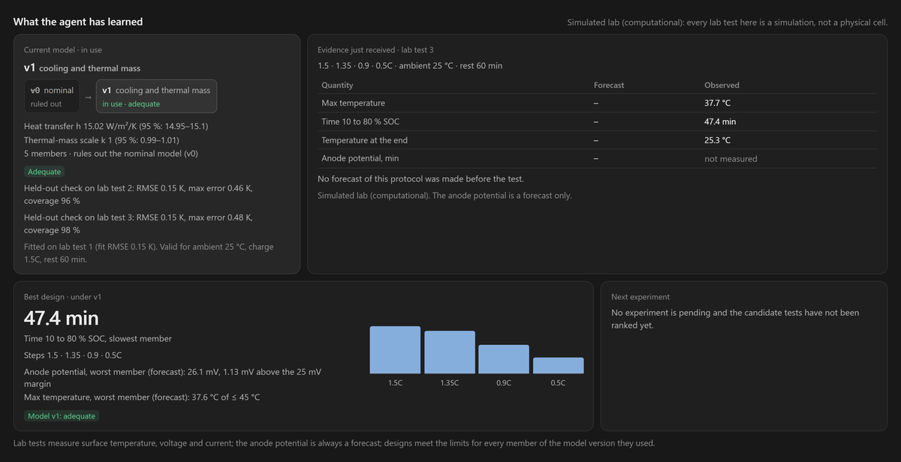

# Translucent in pictures

Translucent runs experiment-loop campaigns. The agent proposes each experiment with a prediction, a person approves
the exact version they read, the result lands in a hash-chained ledger, and the workspace shows what was learned.
The pictures below are screenshots of the web app replaying one recording,
`web/public/fixtures/loop/fastcharge-lab.loop.json` (`/w/?recording=fastcharge-lab`). Every lab test in it is a
simulation of a lab fixture, not a physical cell, and the anode potential is always a forecast, never a measurement.

## The campaign at a glance

The objective asks for the fastest charge from 10 to 80 % SOC that keeps the anode potential at or above +25 mV and
the cell at or below 45 °C. The best design, found under model v1, takes 47.4 min with a forecast anode potential of
26.1 mV and a forecast maximum of 37.6 °C for the worst member. The agent concluded the campaign as feasible only in
simulation.

## What the agent learned

The agent ran a first lab test at 1.5C in every step and fitted model v1, cooling and thermal mass, to it: heat
transfer h 15.02 W/m²/K (95 %: 14.95–15.1), thermal-mass scale k 1 (95 %: 0.99–1.01), five members, fit RMSE
0.15 K. v1 rules out the nominal model, v0. It passed held-out checks on lab tests 2 and 3 (RMSE 0.15 K both
times). The design optimized under v1, 1.5, 1.35, 0.9 then 0.5C, was then run as lab test 3: 47.4 min from 10 to
80 % SOC and a maximum of 37.7 °C observed in the simulated lab.
